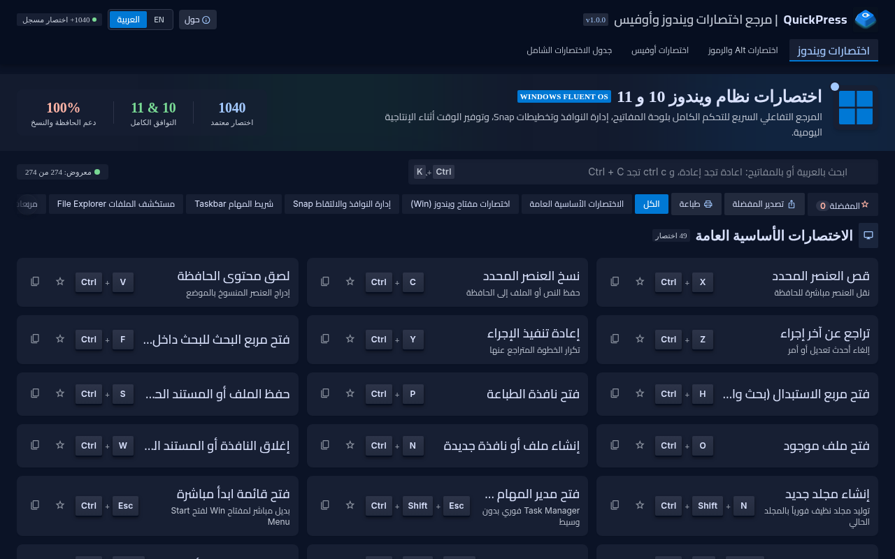
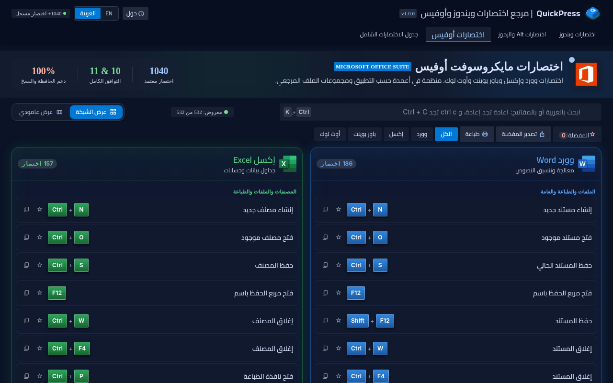
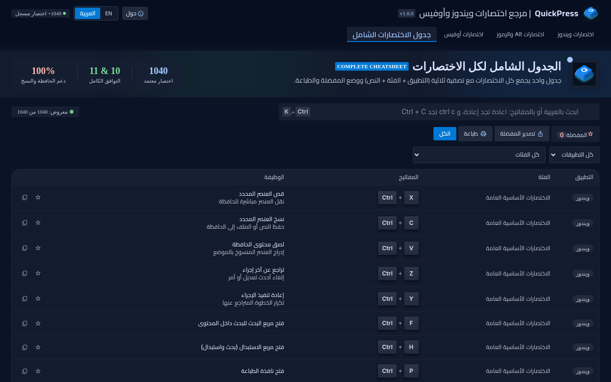
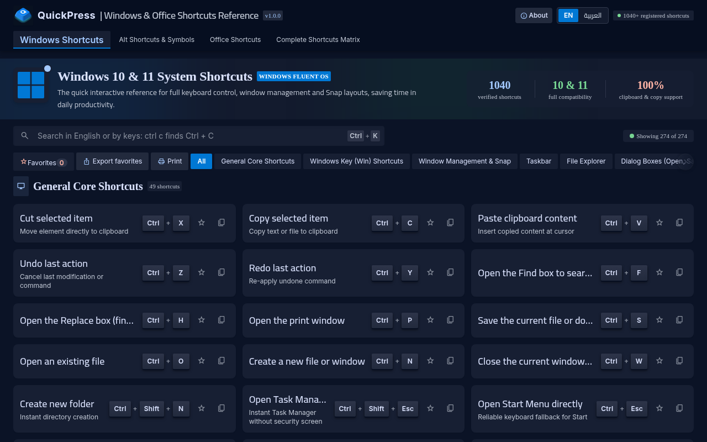

<div align="center">


# QuickPress

**مرجع كامل لاختصارات لوحة المفاتيح — عربي / English — يعمل دون اتصال بالإنترنت**

   

**1040 اختصاراً** · ثماني صفحات · بدون خادم وبدون تثبيت — انقر مزدوجاً ويعمل

</div>

---

## لقطات الشاشة

| |
|---|
|  |
|  |
|  |
|  |

## نظرة عامة

QuickPress مرجع مكتمل لاختصارات لوحة المفاتيح يجمع **1040 اختصاراً** في تطبيق واحد
يعمل بلا إنترنت ولا خادم ولا تثبيت: يكفي فك الضغط والنقر المزدوج على أي صفحة.
المحتوى ثنائي اللغة بالكامل (عربي / إنجليزي) مع تبديل فوري يحفظ اختيارك، وكل شيء
من الخطوط إلى الأيقونات إلى البيانات محفوظ محلياً داخل المجلد نفسه.

| القسم | العدد |
|---|---:|
| اختصارات ويندوز 10 و 11 | 274 |
| مفتاح Alt: الحروف والرموز | 234 |
| مايكروسوفت أوفيس (Word · Excel · PowerPoint · Outlook) | 532 |
| **الإجمالي** | **1040** |

## المميزات

- **1040 اختصاراً** موثقة بالعربية والإنجليزية من مصدر بيانات واحد (`assets/js/data.js`)
- **ثماني صفحات**: ويندوز · مفتاح Alt · أوفيس · الجدول الموحد — كل منها بالعربية والإنجليزية
- **الجدول الموحد**: كل الاختصارات في جدول واحد مع بحث فوري وتصفية ثلاثية
  (التطبيق + الفئة + النص) ووضع المفضلة وزر طباعة يطبع الجدول فقط
- **المفضلة**: أضف أي اختصار بالنجمة، وتنقل بينه، وصدّرها ملف CSV (ترميز UTF-8 مع BOM يفتح سليماً في Excel)
- **النسخ بنقرة**: انسخ الاختصار أو تسلسله الكامل بزر واحد
- **عرضان لصفحة أوفيس**: شبكي أو عمودي بزر تبديل
- **أصوات نقر خفيفة** عبر Web Audio API مع إمكانية كتمها
- **نافذة «حول»** تعرض الإصدار والمطور والرخصة
- **يعمل دون اتصال 100%**: خطوط Cairo و Inter وأيقونات Material Symbols محلية،
  ولا أي طلب شبكة عند التشغيل (بروتوكول `file://`)

## الصفحات الثمانية

| الصفحة | المحتوى |
|---|---|
| `windows_ar.html` / `windows_en.html` | اختصارات ويندوز 10 و 11 حسب القسم |
| `alt_ar.html` / `alt_en.html` | مفتاح Alt: الحروف والرموز (بما فيها Alt + 1 … 31) |
| `office_ar.html` / `office_en.html` | اختصارات Word و Excel و PowerPoint و Outlook |
| `matrix_ar.html` / `matrix_en.html` | الجدول الموحد لكل الاختصارات مع التصفية |
| `index.html` | نقطة الدخول — يحوّل تلقائياً حسب اللغة المحفوظة |

## التشغيل في المتصفح

1. نزّل المستودع أو استنسخه:
   ```bash
   git clone https://github.com/SaeedBadr112/QuickPress.git
   ```
2. افتح المجلد وانقر مرتين على `index.html` (أو أي صفحة مباشرة).
3. يعمل التطبيق كاملاً في المتصفح — بلا إنترنت وبلا أي خطوة إضافية.

> ويمكن أيضاً نشره مجاناً عبر GitHub Pages لأنه موقع ثابت خالص.

## بناء نسخة ويندوز (exe) باستخدام إلكترون

المستودع جاهز للبناء مباشرة دون أي تعديل:

1. ثبّت [Node.js LTS](https://nodejs.org) ثم افتح نافذة CMD داخل مجلد المشروع.
2. نزّل أدوات البناء (أول مرة فقط، يحتاج إنترنت):
   ```bash
   npm install
   ```
3. ابنِ ملفات exe:
   ```bash
   npm run dist
   ```
4. ستجد النتيجة في مجلد `dist`:

   | الملف | الوصف |
   |---|---|
   | `QuickPress-Setup-1.0.0.exe` | نسخة تثبيت مع اختصار سطح المكتب وقائمة ابدأ |
   | `QuickPress-Portable-1.0.0.exe` | نسخة محمولة تعمل بدون تثبيت |

- لتجربة التطبيق داخل إلكترون قبل البناء: `npm start`
- بناء نسخة واحدة فقط: `npm run dist:nsis` أو `npm run dist:portable`
- عند أول تشغيل قد يظهر تحذير SmartScreen لأن الملف غير موقّع رقمياً؛ اختر
  «More info» ثم «Run anyway».
- التفاصيل الكاملة خطوة بخطوة في ملف [تعليمات بناء ملف exe.txt](تعليمات%20بناء%20ملف%20exe.txt).

## بنية المشروع

```text
QuickPress/
├── index.html                 ← نقطة الدخول (تحويل تلقائي حسب اللغة)
├── windows_ar.html · windows_en.html
├── alt_ar.html · alt_en.html
├── office_ar.html · office_en.html
├── matrix_ar.html · matrix_en.html
├── main.js                    ← تشغيل التطبيق في إلكترون
├── package.json               ← إعدادات إلكترون و electron-builder
├── تعليمات بناء ملف exe.txt
├── LICENSE.txt
├── screenshots/               ← لقطات الشاشة
├── assets/
│   ├── js/                    ← app.js · data.js (مصدر البيانات الواحد) · i18n.js
│   ├── css/                   ← tailwind.css · fonts.css · material-symbols.css
│   ├── fonts/                 ← Cairo · Inter · Material Symbols (محلية)
│   └── img/                   ← الشعارات والأيقونات + logo.ico
├── src/input.css · tailwind.config.js   ← لإعادة بناء ملف CSS (اختياري)
├── سجل المراحل.txt            ← توثيق مراحل التطوير
└── check-data.js · check-import.js · import-notes.txt · needs-review.txt
```

## ملاحظات تقنية

- **مصدر بيانات واحد**: كل الاختصارات في `data.js` — كل عنصر يضم `id` و `page` و
  `app` و `section` و `keys` والنسخ للنسخ والوصفين `ar` و `en` والوسوم.
- **JavaScript خالص**: لا إطارات ولا وحدات ولا `fetch` — تعمل الصفحات من `file://` مباشرة.
- **Tailwind v3 مبني محلياً**: ملف `assets/css/tailwind.css` جاهز، ويمكن إعادة بنائه
  بـ `npm run build:css`.
- **الإعدادات محلية**: اللغة والمفضلة في `localStorage`، فتبقى بعد الإغلاق.
- **الأصوات**: Web Audio API دون أي ملفات صوت خارجية.

## About (English)

QuickPress is a fully offline, bilingual (Arabic/English) keyboard shortcuts
reference covering **1,040 shortcuts**: 274 Windows 10/11 shortcuts, 234 Alt
codes, and 532 Microsoft Office shortcuts (Word, Excel, PowerPoint, Outlook).
No server, no install, no internet — just open `index.html` in any browser.
The repo also ships an Electron wrapper (`main.js` + `package.json`), so a
Windows `.exe` is one command away:

```bash
npm install
npm run dist   # → dist/QuickPress-Setup-1.0.0.exe + QuickPress-Portable-1.0.0.exe
```

| | |
|---|---|
| Shortcuts | 1,040 (Windows 274 · Alt 234 · Office 532) |
| Pages | 8 — Windows / Alt / Office / Matrix × AR / EN |
| Platform | Windows 10 & 11 — and any modern browser |
| Offline | 100% — local fonts, icons and data |
| Favorites | Star + export to CSV (UTF-8 BOM) |
| License | MIT — see [LICENSE.txt](LICENSE.txt) |

## التواصل

**سعيد بدر (Saeed Badr)**
البريد الإلكتروني: saeedbadr112@hotmail.com
المستودع: [github.com/SaeedBadr112/QuickPress](https://github.com/SaeedBadr112/QuickPress)

## الرخصة

هذا المشروع مرخّص تحت رخصة [MIT](LICENSE.txt).
